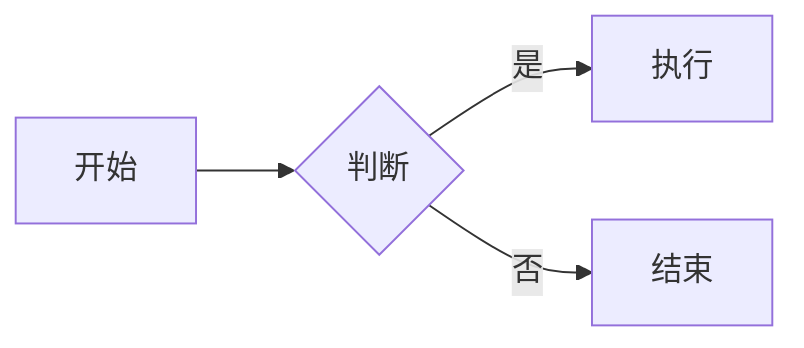

# Markdown任务列表与扩展语法

## 1. 任务列表

### 基本写法

- [x] 已完成的任务
- [ ] 未完成的任务

说明：列表项后加[ ]表示未完成，[x]表示已完成，方括号内必须有空格或x，属于GFM扩展语法

## 2. 脚注

### 引用与定义

这是一句需要注释的话[^1]。

[^1]: 这里是脚注的内容。

说明：正文用[^标记]引用，在文档任意位置用[^标记]: 内容定义，渲染时会自动编号并放到页面底部

## 3. 转义字符

### 显示特殊符号

\*这不是斜体\*

\# 这不是标题

说明：在特殊符号前加反斜杠\可以按原样显示，常见需转义的有\* \_ \# \` \[ \]

## 4. 嵌入HTML

### 使用HTML标签

点击展开

这里是折叠的内容。

说明：Markdown允许直接写HTML，用于实现原生语法做不到的效果，如折叠、上下标2、键盘按键<kbd>Ctrl</kbd>

## 5. 警示块

### GitHub风格提示

> [!NOTE]
> 这是一条提示信息。

> [!WARNING]
> 这是一条警告信息。

说明：GitHub支持NOTE、TIP、IMPORTANT、WARNING、CAUTION五种提示块，其他渲染器可能显示为普通引用

## 6. 流程图

### Mermaid代码块

说明：用mermaid语言的代码块绘制流程图、时序图等，GitHub等平台可以直接渲染

## 7. 自动链接与删除线

### 其他常用语法

https://github.com 会自动变成链接

~~这段文字被删除了~~

说明：GFM会自动识别网址；用两个波浪线包裹文本表示删除线
